<a href="https://tonymed.dev"><picture><source media="(prefers-color-scheme: dark)" srcset="assets/hero-dark.svg"><source media="(prefers-color-scheme: light)" srcset="assets/hero-light.svg"></picture></a>

<picture><source media="(prefers-color-scheme: dark)" srcset="assets/about-dark.svg"><source media="(prefers-color-scheme: light)" srcset="assets/about-light.svg"></picture>

<h3>Selected work</h3>

<!-- projects:start -->
<a href="https://mobilidadurbanaitm.vercel.app"><picture><source media="(prefers-color-scheme: dark)" srcset="assets/project-hackapony-dark.svg"><source media="(prefers-color-scheme: light)" srcset="assets/project-hackapony-light.svg"></picture></a>
<a href="https://github.com/TonyMed12/ProjeXus"><picture><source media="(prefers-color-scheme: dark)" srcset="assets/project-projexus-dark.svg"><source media="(prefers-color-scheme: light)" srcset="assets/project-projexus-light.svg"></picture></a> 
<a href="https://caamorelia.vercel.app"><picture><source media="(prefers-color-scheme: dark)" srcset="assets/project-adopciones-caam-dark.svg"><source media="(prefers-color-scheme: light)" srcset="assets/project-adopciones-caam-light.svg"></picture></a>
<picture><source media="(prefers-color-scheme: dark)" srcset="assets/project-alvare-ditana-dark.svg"><source media="(prefers-color-scheme: light)" srcset="assets/project-alvare-ditana-light.svg"></picture> 
<a href="https://github.com/TonyMed12/gestor-cfdi"><picture><source media="(prefers-color-scheme: dark)" srcset="assets/project-gestor-cfdi-dark.svg"><source media="(prefers-color-scheme: light)" srcset="assets/project-gestor-cfdi-light.svg"></picture></a>
<!-- projects:end -->

<h3>GitHub activity</h3>

<picture><source media="(prefers-color-scheme: dark)" srcset="assets/activity-dark.svg"><source media="(prefers-color-scheme: light)" srcset="assets/activity-light.svg"></picture>

 

Happy holidays ❄

