<picture><source media="(prefers-color-scheme: dark)" srcset="assets/hero-dark.svg"><source media="(prefers-color-scheme: light)" srcset="assets/hero-light.svg"></picture>

<picture><source media="(prefers-color-scheme: dark)" srcset="assets/about-dark.svg"><source media="(prefers-color-scheme: light)" srcset="assets/about-light.svg"></picture>

<h3>GitHub activity</h3>

<picture><source media="(prefers-color-scheme: dark)" srcset="assets/activity-dark.svg"><source media="(prefers-color-scheme: light)" srcset="assets/activity-light.svg"></picture>

 

Happy holidays ❄

